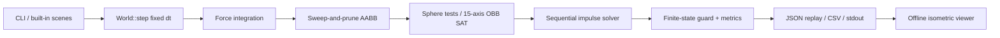

# Architecture and execution flow

QuantumBody is split into a small public C++ library and a command-line host. The library owns the simulation state; scene creation and output formats stay outside the solver.

## Modules

- `math.hpp`: double-precision vectors, quaternions, and rotated diagonal inverse inertia.
- `world.hpp`: shapes, rigid-body state, solver settings, contacts, metrics, and the `World` API.
- `world.cpp`: integration, conservative oriented-box AABBs, sweep-and-prune, narrow phase, and contact impulses.
- `scenes.cpp`: deterministic seeded scene generators.
- `main.cpp`: CLI, replay JSON, CSV, and summary statistics.
- `web/`: browser-only replay controls and isometric drawing.

## One simulation step

1. Reject non-positive or non-finite `dt`.
2. Integrate gravity, accumulated force/torque, linear velocity, position, angular velocity, and quaternion orientation.
3. Build a world AABB per body, sort proxies by minimum x, then inspect only x-overlapping pairs and reject y/z misses.
4. Run shape-specific narrow-phase checks for remaining pairs.
5. Iterate contact impulses. Normal impulses are accumulated and clamped to be non-negative. Tangential impulses are accumulated and clamped to the Coulomb friction disk.
6. Check for non-finite position, velocity, or orientation; update counters and last-step wall time.

Bodies use stable vector indices as IDs. Static bodies have zero inverse mass and inverse inertia. Shapes currently have uniform restitution and friction values per body.

## Determinism

Scene randomness is seeded with `std::mt19937`; the solver visits bodies, proxy pairs, and contacts in stable order. With the same compiler/runtime, seed, initial state, and fixed-step sequence, results should repeat. Cross-platform bitwise determinism is not promised because floating-point implementations may differ.

## Metrics

`StepStats` holds the total step count and the broad-phase candidate count, contact count, and wall duration of the most recent step. The CLI samples wall duration at each step and reports p50/p95/p99 plus throughput. These are local measurements, not performance guarantees.

## Extension seams

The next maintainable boundaries are a persistent contact manifold between broad and narrow phases, a constraint pass after contact solving, and a separate particle subsystem for SPH/XPBD. A GPU backend should use explicit state buffers and compare outputs against the CPU reference. It is not wired into the current `World` API yet.
